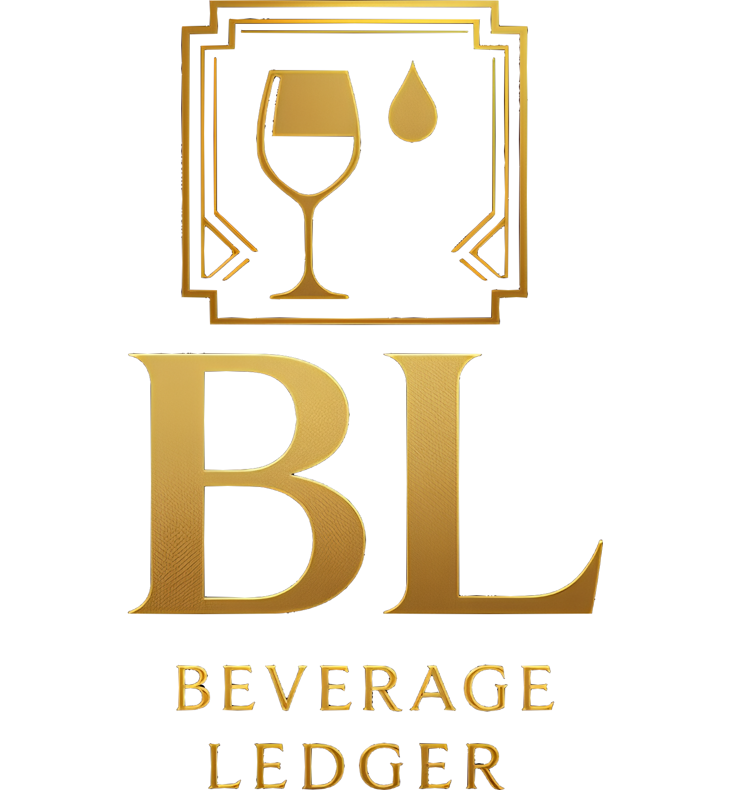

<div align="center">
  
  
  # Beverage Ledger
  **Professional Casino Liquor Inventory Management System**
  
  [](https://nextjs.org/)
  [](https://www.typescriptlang.org/)
  [](https://tailwindcss.com/)
  [](#-copyright-notice)
  
  ---
  
  ### **[LIVE DEMO](https://beverage-ledger.vercel.app)** 
  **Try the application: [beverage-ledger.vercel.app](https://beverage-ledger.vercel.app)**
</div>

---

## 🚨 **LEGAL DISCLAIMER**

> **⚠️ IMPORTANT NOTICE**: This software is an **INDEPENDENT PROJECT** and is **NOT affiliated, associated, authorized, endorsed by, or in any way officially connected** with any casino, resort, gaming company, or hospitality business. 
> 
> Any trade names, logos, or brand names mentioned are used for **EDUCATIONAL AND DEMONSTRATIVE PURPOSES ONLY** and are the property of their respective owners.
> 
> This is a **GENERIC INVENTORY MANAGEMENT SYSTEM** that can be adapted for various hospitality environments.

---

## 🎰 About the Project

The **Beverage Ledger** is a sophisticated, casino-themed liquor inventory management system designed for premium casino operations. This application provides comprehensive tracking, management, and reporting capabilities for beverage operations in high-end casino environments.

### ✨ Key Features

- **🍾 Real-time Inventory Tracking** - Monitor liquor bottles and cases with precision
- **📊 Advanced Analytics** - Comprehensive statistics with customizable time ranges
- **📋 Movement History** - Complete audit trail of all inventory transactions
- **🧾 PDF Invoice Generation** - Professional invoice creation with casino branding
- **🎨 Casino-themed UI** - Elegant gold and black design matching casino aesthetics
- **📱 Responsive Design** - Optimized for desktop, tablet, and mobile devices
- **🔍 Smart Search & Filtering** - Quick access to specific liquors and movements
- **⚡ Performance Optimized** - Built with Next.js 15 and modern React patterns

### 🎯 Target Environment

This system is purpose-built for:
- **Premium casino operations** and beverage management
- High-volume liquor inventory management
- Professional casino hospitality environments
- Real-time tracking of premium spirits and wines

---

## 🛠️ Technology Stack

### Frontend
- **Next.js 15.5.2** - React framework with App Router
- **TypeScript** - Type-safe development
- **Tailwind CSS** - Utility-first styling with custom casino theme
- **React Hooks** - Modern state management with useReducer patterns

### Backend & Database
- **Neon Database** - Serverless PostgreSQL
- **Server Actions** - Type-safe server functions
- **PDF Generation** - Custom invoice creation

### Architecture
- **Component-based Design** - 13 modular, reusable components
- **Clean Code Principles** - Maintainable and scalable codebase
- **Type Safety** - Complete TypeScript implementation
- **Responsive Design** - Mobile-first approach

## 📁 Project Structure

```
beverage-ledger/
├── public/
│   ├── bl-logo.png          # Casino branding logo
│   └── favicon.ico
├── src/
│   ├── app/
│   │   ├── actions.ts        # Server actions for movements
│   │   ├── actions-licores.ts # Liquor data management
│   │   ├── layout.tsx        # App layout
│   │   ├── page.tsx          # Main application (432 lines, refactored from 1460)
│   │   └── api/              # API routes
│   └── components/
│       ├── Calendar/         # Date selection component
│       ├── Modals/          # Confirmation and cancellation modals
│       ├── MovementCard/    # Individual movement display
│       ├── Navigation/      # Section navigation tabs
│       ├── NotificationSystem/ # Toast notifications
│       ├── ScrollToCheckoutButton/ # UX enhancement
│       └── Sections/        # Main content sections
│           ├── SelectionSection.tsx    # Liquor selection interface
│           ├── HistorySection.tsx      # Movement history
│           └── StatisticsSection.tsx   # Analytics dashboard
├── tailwind.config.js       # Custom casino theme configuration
└── README.md
```

---

## 🧪 Pruebas

El repositorio tiene siete tipos de prueba. Cinco corren con **Vitest** y no necesitan red. Las E2E de **Serenity/JS** necesitan la aplicación levantada, y las de **Katalon** se graban y ejecutan a mano.

| Tipo | Ubicación | Pruebas | Comando | Qué necesita |
|---|---|---:|---|---|
| Caja blanca | `tests/*.test.ts` | 95 | `pnpm vitest run tests/rf-` | Solo dependencias |
| Regresión | `tests/regression/` | 65 | `pnpm test:regression` | Solo dependencias |
| API | `tests/api/` | 72 | `pnpm test:api` | Solo dependencias |
| Rendimiento | `tests/performance/` | 38 | `pnpm test:performance` | Solo dependencias |
| Seguridad | `tests/security/` | 83 | `pnpm test:security` | Solo dependencias |
| E2E Screenplay | `tests/e2e/` | 11 escenarios | `pnpm test:e2e` | Front en `:3000`, API accesible, cuenta real y Chromium |
| E2E Katalon | `docs/katalon/` | 9 casos | Desde Katalon Studio | Katalon Studio, Chrome, front en `:3000` y cuenta real |

### Requisitos comunes

- **Node.js 20 o superior** (probado con 24) y **pnpm**, fijado en `packageManager`. No uses `npm install`.
- Instalar dependencias una vez:

  ```bash
  pnpm install
  ```

### Pruebas con Vitest: caja blanca, regresión, API, rendimiento y seguridad

**Qué necesitan:** solo `pnpm install`. No llaman a ninguna API: reemplazan `fetch` por un doble de prueba y ejecutan el cliente real (`openapi-fetch`, middleware de autenticación, `unwrap`, `ApiError`) contra respuestas preparadas. No hace falta `.env`: si falta `NEXT_PUBLIC_API_URL`, Vitest usa `http://localhost:3001`, que nunca se contacta.

```bash
pnpm test                    # todas las suites de Vitest (353 pruebas)
pnpm test:coverage           # lo mismo + coverage/lcov.info (lo que publica Sonar)

pnpm vitest run tests/rf-    # solo caja blanca (archivos sueltos en tests/)
pnpm test:regression         # solo regresión
pnpm test:api                # solo API
pnpm test:performance        # solo rendimiento
pnpm test:security           # solo seguridad
```

Para afinar más:

```bash
pnpm vitest run tests/api/rf-22-api-stock-levels.test.ts   # un archivo
pnpm vitest run rf-24                                      # todos los archivos de un RF
pnpm vitest run tests/security -t "XSS"                    # pruebas cuyo nombre coincide
pnpm vitest                                                # modo watch mientras se edita
```

- **Rendimiento** mide tiempos contra presupuestos holgados (`tests/performance/support/perf.ts`). En una máquina muy cargada pueden fallar por tiempo. Si pasa, conviene repetir la corrida antes de dar por mala la prueba.
- **Seguridad** renderiza componentes reales en jsdom con los mensajes en español, así que un cambio de copy en `src/i18n/messages/es.json` puede romperla.

### E2E con Serenity/JS (patrón Screenplay)

**Qué necesitan:**

1. El navegador de Playwright, instalado una vez:

   ```bash
   pnpm exec playwright install chromium
   ```

2. Una cuenta real de la organización en `.env` (ver `.env.example`):

   ```
   TEST_USER_EMAIL="..."
   TEST_USER_PASSWORD="..."
   ```

3. El front levantado en `http://localhost:3000` y apuntando a una API accesible. Con la API desplegada en Render, `CORS_ORIGINS` tiene que incluir `http://localhost:3000`:

   ```bash
   NEXT_PUBLIC_API_URL=https://beverage-ledger-api.onrender.com pnpm dev
   ```

4. Que la actriz use **la misma API** cuando la llama directamente (escenario de RF-27), con `E2E_API_URL`. Si falta, usa `NEXT_PUBLIC_API_URL`.

**Cómo ejecutarlas**, en otra terminal:

```bash
E2E_API_URL=https://beverage-ledger-api.onrender.com pnpm test:e2e   # todos los escenarios
pnpm test:e2e tests/e2e/features/rf-24-kardex.feature                # un feature
pnpm test:e2e --tags @rf-23                                          # por etiqueta (@smoke, @rf-19…@rf-28)
pnpm test:e2e --name "Credenciales inválidas"                        # un escenario por nombre
HEADLESS=false pnpm test:e2e                                         # viendo el navegador
pnpm test:e2e:report                                                 # abrir el informe HTML (reports/serenity-js)
pnpm typecheck:e2e                                                   # solo compilar la suite
```

En PowerShell las variables se ponen antes: `$env:E2E_API_URL='https://beverage-ledger-api.onrender.com'; pnpm test:e2e`.

- **Tarda alrededor de un minuto y medio, a propósito.** La API limita login y refresh a 10 por minuto por IP, así que la suite espera 7 segundos entre inicios de sesión. Antes de repetirla, deja pasar un minuto.
- **Si la API de Render estaba dormida,** la primera petición puede tardar hasta un minuto. Las esperas lo toleran.
- **No escriben en el ledger.** El escenario de RF-19 deja un borrador solo en el navegador de la prueba y lo descarta al terminar.
- **Dependen de los datos actuales:** RF-23 busca «AMARO» y RF-24 abre el primer producto de la lista, que tiene que tener al menos un movimiento confirmado.
- Detalle de la arquitectura Screenplay (Actor, Abilities, Tasks, Actions y Questions) en [`tests/e2e/README.md`](tests/e2e/README.md).

### E2E con Katalon Studio

**Qué necesitan:** Katalon Studio (la edición gratuita alcanza) con una cuenta de Katalon, Chrome, el front levantado como en el punto 3 de la sección anterior y la cuenta de pruebas.

**Cómo ejecutarlas:** se graban a mano con Web Recorder y se corren desde Katalon. Abre la *Test Suite* `Suite E2E` y pulsa **Run → Chrome**. El reporte se exporta desde la carpeta *Reports*. La guía paso a paso, con los 9 casos, los selectores estables y los problemas típicos, está en [`docs/katalon/README.md`](docs/katalon/README.md).

### En integración continua

- **GitHub Actions** (`.github/workflows/sonar.yml`) y **Jenkins** (`Jenkinsfile`) corren `pnpm test:coverage`, es decir, las cinco suites de Vitest, y publican el coverage en SonarCloud o en SonarQube.
- Las E2E de Serenity/JS y de Katalon **no** corren en CI, porque necesitan el front levantado y una cuenta real.

---

## 🌐 Live Demo & Deployment

### 🚀 **Production Demo**
**Experience the full application:** [https://beverage-ledger.vercel.app](https://beverage-ledger.vercel.app)

**Demo Features:**
- ✅ **Full functionality** - All features available for testing
- ✅ **Real-time database** - Persistent data storage
- ✅ **Responsive design** - Test on any device
- ✅ **PDF generation** - Download sample invoices
- ✅ **Live statistics** - Interactive analytics dashboard

### 🔧 **Technology Stack**
- **Frontend:** Next.js 15 with TypeScript and Tailwind CSS
- **Backend:** Serverless functions with Neon PostgreSQL
- **Hosting:** Vercel with automatic deployments
- **Domain:** Custom subdomain with SSL encryption

### 📱 **Compatibility**
- **Desktop:** Chrome, Firefox, Safari, Edge
- **Mobile:** iOS Safari, Android Chrome
- **Tablets:** iPad, Android tablets
- **Performance:** Optimized for fast loading and smooth interactions

---

## 🎨 Design Philosophy

The application embraces a **casino aesthetic** with:
- **Gold Accent Color** (`#D4AF37`) - Representing luxury and elegance
- **Dark Background** (`#120006`) - Professional casino atmosphere
- **Smooth Animations** - Sophisticated transitions between sections
- **Typography** - Clean, readable fonts suitable for operational use
- **Responsive Layout** - Optimized for various screen sizes and devices

---

## 👨‍💻 Author

**Tomás Córdoba Urquijo**
- Software Developer & Technology Specialist

---

## ⚠️ IMPORTANT DISCLAIMER

**TRADEMARK NOTICE**: This software is an independent project and is **NOT officially affiliated, endorsed, sponsored, or approved** by any casino, resort, or hospitality company. Any similarities to existing casino operations or brands are purely coincidental.

**INTENDED USE**: This system is designed as a general-purpose beverage inventory management solution that can be adapted for various hospitality environments.

**LIABILITY**: The author assumes no responsibility for any trademark infringement claims or legal issues arising from the use of this software.

**📋 For complete legal terms, see [DISCLAIMER.md](./DISCLAIMER.md)**

---

## 🚫 COPYRIGHT NOTICE

**© 2025 Tomás Córdoba Urquijo. All Rights Reserved.**

This software is proprietary and confidential. Unauthorized copying, distribution, modification, public display, public performance, or other use of this software and associated documentation files is strictly prohibited and may violate copyright law.

### 🔒 Licensing

**NO PERMISSION IS GRANTED TO:**
- Copy, modify, or distribute this software
- Use this software for commercial or personal purposes without explicit written authorization
- Create derivative works based on this software
- Reverse engineer or decompile this software

**⚠️ IMPORTANT:** This software may only be used with explicit written authorization from Tomás Córdoba Urquijo.

For licensing inquiries, contact: **Tomás Córdoba Urquijo**

### ⚖️ Legal Protection

This software and all associated materials are protected under:
- Copyright laws
- International copyright treaties  
- Intellectual property laws and treaties

**Violation may result in civil penalties, criminal prosecution, monetary damages, and permanent injunction.**

---

<div align="center">
  
</div>
